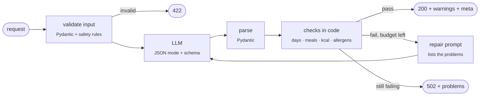

# NutriPilot AI

### A serverless nutrition planner that checks the LLM's work: structured outputs, code-verified calories and allergens, with Groq, OpenAI or Claude on AWS Lambda

[](https://github.com/Hadi2468/nutripilot-ai/actions/workflows/ci.yml)
[](https://www.python.org/)
[](https://fastapi.tiangolo.com/)
[](https://aws.amazon.com/lambda/)
[](LICENSE)

Ask an LLM for a 2,000 kcal vegetarian week without peanuts and you get a nicely formatted
answer whose days add up to 1,650 or 2,400 kcal, and which may still have peanut sauce on
Thursday. The text *looks* right; nothing checks it.

NutriPilot AI treats the LLM as an untrusted component. Every feature asks for **JSON that
matches a Pydantic schema**, then **code** checks the answer: seven days, the right number
of meals, each day's calories within ±10% of the target, and **no allergen or disliked food
anywhere in a dish or its ingredients**. If a check fails, the problems go back to the model
for one bounded repair; if it still fails, the API returns **502 instead of an unsafe plan**.
Totals are summed in code, never trusted from the model.

---

## ✨ Highlights

| Capability | How |
|---|---|
| **Structured&nbsp;outputs** | Every endpoint returns typed JSON (plans, meals, nutrients, swaps, tips) validated by Pydantic |
| **Checks&nbsp;in&nbsp;code** | Day count, meals per day, daily calories ±10%, excluded foods (whole-word, plural-aware) |
| **Bounded&nbsp;self-repair** | Failed checks are sent back to the model with the exact problems; one repair by default, then 502 |
| **Numbers&nbsp;from&nbsp;code** | Daily and meal totals are computed fields; calories vs macronutrients (Atwater 4/4/9) mismatches become warnings |
| **Safety&nbsp;rules** | No weight-loss plans for under-18s, no adult plans below 1,200 kcal, audience-specific guidance for children, teens and older adults, a clinician warning when health conditions are given |
| **Pick&nbsp;your&nbsp;model** | Groq (GPT-OSS, Llama), OpenAI (GPT-4o mini, GPT-4.1) or Claude (Opus 5.5, Sonnet 5.5, Haiku 5.5), chosen per request from the dashboard, the CLI or `?provider=&model=`; every model goes through the same checks |
| **Serverless** | API Gateway (HTTP API) → Lambda (FastAPI + Mangum), keys in Secrets Manager, JSON logs; one SAM template |
| **Observable** | Every response carries provider, model, prompt version, latency, tokens and repair count |
| **Three&nbsp;interfaces,&nbsp;one&nbsp;service** | REST API (bearer auth), `nutripilot` CLI and a Streamlit dashboard share one service layer |
| **Tested&nbsp;offline** | 86 pytest tests with a scripted fake LLM: no keys, no network, no cost; 98% coverage; CI on every push |

---

## 🔀 Architecture


Every request follows the same pipeline:



See **[DESIGN.md](DESIGN.md)** for the checks, the safety policy, the deployment and the trade-offs.

---

## 🚀 Quickstart

```bash
git clone https://github.com/Hadi2468/nutripilot-ai.git
cd nutripilot-ai
python -m venv .venv && source .venv/bin/activate    # Windows: .venv\Scripts\activate
pip install -e ".[api,cli,dashboard,dev]"
cp .env.example .env                                 # add GROQ_API_KEY, OPENAI_API_KEY and/or ANTHROPIC_API_KEY
```

### 1. CLI

```bash
nutripilot plan --calories 2000 --meals 4 --goal "weight loss" --age 45 \
                --preference vegetarian --allergies peanuts --dislikes mushrooms
nutripilot meal --calories 600 --type dinner --preference Mediterranean
nutripilot analyze "2 eggs, 1 slice whole-grain toast, 1 banana"
nutripilot substitute "white rice, soda" --goal "weight loss"
nutripilot --json tips --goal "muscle gain"
nutripilot --model claude-haiku-5-5 analyze "1 cup oatmeal, 1 apple"   # any catalog model
```

### 2. REST API

```bash
uvicorn nutripilot.api:app --reload        # interactive docs at http://localhost:8000/docs
```

| Method | Endpoint | Returns |
|---|---|---|
| `GET` | `/health` | Liveness check (no auth) |
| `POST` | `/v1/nutripilot/plan` | Seven-day plan with per-meal and daily nutrients |
| `POST` | `/v1/nutripilot/plan/regenerate` | A revised plan, held to the same checks |
| `POST` | `/v1/nutripilot/meal` | One meal for a calorie target |
| `POST` | `/v1/nutripilot/analysis` | Per-item nutrients and totals |
| `POST` | `/v1/nutripilot/substitute` | Healthier swaps that respect allergies |
| `GET` | `/v1/nutripilot/recommendations?goal=` | Five tips |
| `GET` | `/v1/nutripilot/models` | The model catalog, and which models have a configured key |

Add `?provider=anthropic&model=claude-haiku-5-5` (or just `?model=...`) to any feature endpoint to
choose the model for that request; without it the configured default is used. Only catalog models
are accepted (422 otherwise), so clients cannot run arbitrary, expensive models.

```bash
curl -X POST localhost:8000/v1/nutripilot/plan -H "Content-Type: application/json" \
     -d '{"meal_preference": "vegetarian", "calories": 2000, "meal_count": 4,
          "goal": "weight loss", "age": 45, "allergies": "peanuts"}'
```

Every response has the same envelope (abridged; values are illustrative):

```jsonc
{
  "type": "weekly_plan",
  "data": {
    "days": [
      { "day": 1,
        "meals": [{ "name": "Breakfast", "dish": "Masala oats with yogurt",
                    "ingredients": ["rolled oats", "greek yogurt", "peas", "spices"],
                    "calories": 480, "protein_g": 24, "carbs_g": 62, "fat_g": 14 }, "..."],
        "totals": { "calories": 1985, "protein_g": 98, "carbs_g": 240, "fat_g": 66 } },
      "..."
    ],
    "notes": ["Batch-cook the dal on Sunday for Days 1-3."]
  },
  "warnings": [],
  "meta": { "provider": "groq", "model": "openai/gpt-oss-20b", "prompt_version": "2.0",
            "latency_ms": 6120, "prompt_tokens": 1630, "completion_tokens": 3410, "repairs": 0 },
  "disclaimer": "AI-generated nutrition information for general wellness only; not medical advice. ..."
}
```

| Status | Meaning |
|---|---|
| `401` | Missing or wrong bearer token (when `NUTRIPILOT_API_TOKEN` is set) |
| `422` | Invalid input, or a safety rule (e.g. weight loss under 18, adult target below 1,200 kcal) |
| `429` | The LLM provider is rate limiting |
| `502` | The model's answer still failed the checks after repair; the body lists the `problems` |
| `503` | The LLM provider is unreachable or not configured |

### 3. Streamlit dashboard

```bash
streamlit run dashboard/app.py            # talks to the API at NUTRIPILOT_API_URL
```

Pick a model in the sidebar (only models whose provider key is configured are offered), generate a plan, see the daily average against your target, calories per day against the
target line, and each day's meals in tabs; then type a change ("more fish, no rice on
weekdays") to revise it. Validation problems and warnings are shown, not hidden.

### 4. Docker

```bash
docker compose up --build                 # API on :8000, dashboard on :8501
```

### 5. Deploy to AWS (SAM)

```bash
aws secretsmanager create-secret --name nutripilot \
    --secret-string '{"GROQ_API_KEY": "gsk_...", "NUTRIPILOT_API_TOKEN": "a-long-random-token"}'

sam build
sam deploy --guided                       # SecretArn = the ARN printed above
```

The stack is an HTTP API (throttled to 10 req/s, burst 20), one arm64 Lambda (Python 3.13,
512 MB, 30 s) and a log group with 30-day retention. The function reads its keys from
Secrets Manager at cold start and **requires** the bearer token. Point the dashboard at the
`ApiUrl` output.

---

## 🧪 Testing

```bash
ruff check . && ruff format --check .
pytest --cov                              # fully offline
cfn-lint template.yaml
```

The LLM sits behind a small `ChatModel` protocol, so tests inject a scripted fake and assert
on behaviour: every check and its boundaries, the repair loop (the problems are sent back,
tokens are summed, the budget is respected), allergens that survive a repair fail with 502,
safety rules return 422, provider errors map to 429/503, bearer auth and fail-closed auth,
Secrets Manager loading, the CLI, and the Lambda handler behind an API Gateway stage.

---

## 🗂️ Project structure

<pre>
<b>nutripilot-ai/</b>
├── src/nutripilot/
│   ├── schemas.py        # requests, LLM outputs (with computed totals), response envelope
│   ├── checks.py         # deterministic checks + non-blocking warnings
│   ├── policy.py         # audience and health-condition guidance, disclaimer
│   ├── prompts.py        # every prompt, versioned (PROMPT_VERSION)
│   ├── llm.py            # Groq / OpenAI / Claude clients behind a ChatModel protocol
│   ├── service.py        # generate → parse → check → repair, one method per feature
│   ├── api.py            # FastAPI app + Lambda handler (Mangum)
│   ├── cli.py            # <b>nutripilot</b> command
│   ├── config.py         # settings (env / .env) and the model catalog
│   └── aws_secrets.py    # Secrets Manager → environment on Lambda
├── dashboard/app.py      # Streamlit UI (API client)
├── tests/                # offline pytest suite
├── template.yaml         # AWS SAM: HTTP API + Lambda + logs
├── Dockerfile · docker-compose.yml
└── .github/workflows/ci.yml
</pre>

---

## ⚙️ Configuration

| Variable | Default | Purpose |
|---|---|---|
| `NUTRIPILOT_PROVIDER` | `groq` | Default provider: `groq`, `openai` or `anthropic` |
| `GROQ_API_KEY` / `OPENAI_API_KEY` / `ANTHROPIC_API_KEY` | — | A key enables that provider's models |
| `NUTRIPILOT_MODEL` | provider default | Default model (<code>openai/gpt&#8209;oss&#8209;20b</code>, <code>gpt&#8209;4o&#8209;mini</code>, <code>claude&#8209;opus&#8209;5&#8209;5</code>) |
| `NUTRIPILOT_TEMPERATURE` | `0.3` | Groq / OpenAI: low, plans should be consistent |
| `NUTRIPILOT_CLAUDE_EFFORT` | `medium` | Claude thinking depth (`low` ... `max`); Claude 5.5 models take effort instead of temperature |
| `NUTRIPILOT_LLM_TIMEOUT_S` | `90` | Per LLM call (12 on Lambda) |
| `NUTRIPILOT_MAX_REPAIRS` | `1` | Extra LLM calls allowed to fix a failed check |
| `NUTRIPILOT_CALORIE_TOLERANCE` | `0.10` | Allowed daily calorie error |
| `NUTRIPILOT_API_TOKEN` | *(empty)* | Enables bearer auth (`API_TOKEN` also accepted) |
| `NUTRIPILOT_AUTH_REQUIRED` | `false` | Fail closed if no token is configured (`true` on Lambda) |
| `NUTRIPILOT_API_URL` | `http://localhost:8000` | Where the dashboard finds the API |

---

## ↪️ Upgrading from v1

v2 changes the API contract from free text to structured JSON:

- `data` is now an object (plan, meal, analysis, swaps or tips), and every response adds `warnings`, `meta` and `disclaimer`.
- `/meal` takes a meal request (`meal_type`, `calories`, `goal`, ...) instead of a full profile.
- `/plan/regenerate` takes `{profile, existing_plan, modification_request}`, so the revision is checked against the same profile.
- `/analysis` returns per-item nutrients with `totals` instead of four top-level numbers.
- `goal` is one of `weight loss`, `maintenance`, `muscle gain`, `weight gain`, `healthy eating` (case-insensitive), and `allergies` is new.

---

## ⚠️ Disclaimer

NutriPilot AI is an educational and software engineering project. Its output is **not
medical advice**. Nutrient values are model estimates, not lab measurements. Consult a
doctor or registered dietitian for medical conditions, pregnancy, food allergies or
eating disorders, and a paediatrician for children.

---

## 🛣️ Roadmap

➡️ Ground nutrient values in the USDA FoodData Central database via a tool call  
➡️ Compute calorie targets from age, sex, height, weight and activity (Mifflin-St Jeor)  
➡️ Offline evaluation set: allergen recall, calorie accuracy and safety across models  
➡️ LangSmith or OpenTelemetry tracing alongside the per-response metadata  

---

## License

MIT

---
## 🧑🏻‍💻 Author
<pre>
<b> Hadi Hosseini </b>    
 AI/ML Engineer | Data Engineer | Biomedical Data Scientist  
 www.linkedin.com/in/hadi468
</pre>
